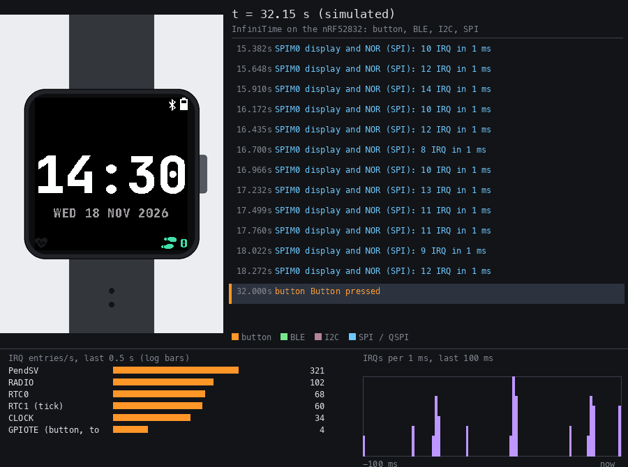

## Run InfiniTime on a simulated PineTime



The same run as an MP4 (1920x1080, 30 fps): [demo.mp4](docs/screens/demo.mp4). Pixels are the ones the firmware clocks into the ST7789 over SPI, scaled up by nearest neighbour; the watch body around them is drawn by `scripts/watch_render.py`. The GIF shows the first 18.6 virtual s (every display change); the run is 40 s.

[InfiniTime](https://github.com/InfiniTimeOrg/InfiniTime) 1.16.1 (GPL-3.0), built for the PineTime (`pinetime-app`, no MCUBoot, linked at 0x0 and loaded directly), unmodified, on pyrite, the Simantic simulator.

| | |
| --- | --- |
| InfiniTime | this tree, tag 1.16.1 (`e172b9b`), `scripts/build_infinitime.sh` (arm-none-eabi-gcc 15, nRF5 SDK 15.3.0) |
| pyrite | `main` at `30e8e101e`; the nRF52832 chip is declared by simantic-dev/pyrite#3710 (merged) on the nRF52840's shared IP models |
| Peers | from `simantic-dev/sim-fixtures` `tests/nrf/pinetime` and `peers/` (#1295, #1307, #1308), copied here |

```sh
./run.sh    # builds InfiniTime if out/ has no image, runs 40 virtual s (about 12 s wall on an Apple M5), writes out/frames/, out/activity.md, the GIF and the MP4
```

**Timeline** (virtual time, one `./run.sh` run).

| Time (s) | What | Image |
| --- | --- | --- |
| 0.027 | first BLE ADV_IND on the air | |
| 1.6 | first frames: boot logo, then the watch face at 00:00, THU 1 JAN 2026 | [png](docs/screens/watchface.png) |
| 6.0 | the phone connects (30 ms connection interval) | |
| 6.04 to 6.10 | phone writes the Current Time characteristic (0x2A2B); the face shows 14:30, WED 18 NOV 2026 and the Bluetooth icon | |
| 10.0 to 11.38 | phone walks the GATT characteristic declarations to find New Alert (0x2A46), 60 ms per round trip | |
| 11.38 | phone writes one alert, "Alex" / "Lunch 12:30?", in the format of `doc/ble.md`; accepted at 11.44, drawn from 11.5 | [png](docs/screens/notification.png) |
| 32.0 | side button (P0.13) held 150 ms: InfiniTime turns the display off | |


### What is real and what is simulated

The firmware is real: unmodified InfiniTime, built from this tree. On the chip, pyrite's shared nRF52840 IP models (CPU, GPIOTE, SPIM/TWIM, RTCs, timers, SAADC, radio) declared with the nRF52832 memory map. Off the chip, one Python model per part in `peers/`, wired up in `sim/overlay.board` after InfiniTime's `src/drivers/PinMap.h`:

- **ST7789 LCD** `peers/spi/st7789.py`: decodes the panel's commands and frame memory and saves every frame as a PNG named by virtual microseconds (this fork changes the peer's `{n}` from a frame counter to the time, for `scripts/demo_gif.py`).
- **XT25F32 NOR** `peers/spi/xt25f32.py`; **CST816S touch** `peers/i2c/cst816s.py` (no touches scripted here).
- **Phone** `peers/ble/phone.py`: pyrite's scripted BLE central. Connects, writes the time over the Current Time Service, writes one alert to the Alert Notification Service. InfiniTime is also a GATT client of the phone; every request it sends gets "attribute not found".
- **Buttons and charger** `peers/gpio/pin_script.py`.
- **MODELED SIMPLIFICATION:** the BMA421 accelerometer (0x18) and HRS3300 heart-rate sensor (0x44) are register files (chip id only). They stand in for the sensors: no samples, no step count, no motion or heart-rate interrupts, so every sensor-driven wakeup on silicon is absent from the study below.
- **MODELED SIMPLIFICATION:** the battery is a fixed 3.9 V on SAADC AIN7, charger unplugged.

### Activity study

Activity, not energy: no current or joule is fitted anywhere. From one run (`out/activity.md`, made by `scripts/activity.py` from `--trace-interrupts` and two `--trace-symbol` hooks on the WFE in FreeRTOS's `vPortSuppressTicksAndSleep`, `src/FreeRTOS/port_cmsis_systick.c:181`):

- **awake**: share of the window the CPU is outside that WFE loop. It is the only place InfiniTime sleeps (the one `wfe` in the image).
- **wakeups/s**: exits from that loop.
- **IRQ entries/s**: exception entries, total and by source. Radio on-time is not measured; RADIO IRQ entries stand in for radio events.

| Phase | window (s) | awake | wakeups/s | IRQ entries/s | top sources (entries/s) |
|---|---|---|---|---|---|
| boot | 0-2 | 65.1% | 268 | 2092 | SPIM0 (display, NOR) 762, RTC1 (tick) 659, PendSV 328, RADIO 174, RTC0 116 |
| advertising, watch face | 2-6 | 7.8% | 292 | 772 | PendSV 383, RADIO 174, RTC0 116, RTC1 (tick) 70, POWER_CLOCK 29 |
| connected, watch face | 7-10 | 7.3% | 235 | 576 | PendSV 312, RADIO 100, RTC0 67, RTC1 (tick) 64, POWER_CLOCK 33 |
| notification shown | 11-18 | 15.4% | 567 | 2099 | SPIM0 (display, NOR) 1396, PendSV 372, RTC1 (tick) 131, RADIO 100, RTC0 67 |
| connected, watch face idle | 19-32 | 7.1% | 230 | 575 | PendSV 311, RADIO 100, RTC0 67, RTC1 (tick) 63, POWER_CLOCK 33 |
| connected, display off | 33-40 | 2.5% | 206 | 437 | PendSV 220, RADIO 100, RTC0 67, POWER_CLOCK 33, RTC1 (tick) 17 |

Task switches in the idle watch-face window (19-31 s, from a hook on `PendSV_Handler` after `vTaskSwitchContext`): IDLE 184/s, nimble LL 67/s, displayapp 50/s, MAIN (SystemTask) 11/s.

**Caveats.** Timing is the nRF52840 core table; the 52832 is not measured. The connection interval (30 ms) and its 33 radio events/s are the scripted phone's choice, so "connected" rows depend on the phone. Advertising was measured only in the fast-advertising window. There is no sleeping-display advertising phase, and no silicon reference run yet.

**Ranked findings** (by activity removed, each tied to a code location; none is a claim about energy):

1. **displayapp wakes 50 times a second on a static watch face** (and keeps the CPU awake ~7% of the time with the display on, against 2.5% with it off). `DisplayApp.cpp:266` passes the return of `lv_task_handler()` to the next `xQueueReceive` timeout, and LVGL's refresh and input timers are 20 ms (`src/libs/lv_conf.h:45` `LV_DISP_DEF_REFR_PERIOD`, `:115` `LV_INDEV_DEF_READ_PERIOD`). Letting LVGL's timers idle longer when nothing is animating removes most of the 50/s.
2. **The SPI display path costs about 1400 IRQs/s while a screen animates** (notification window), against 0 on the static face. `SpiMaster::Write` (`src/drivers/SpiMaster.cpp`) waits for `EVENTS_END` by polling (`while (spiBaseAddress->EVENTS_END == 0)`), so the CPU is held awake for each transfer as well. Larger EasyDMA transfers per flush and waiting on the IRQ instead of polling would reduce both.
3. **Fast advertising runs for the first 30 s of every advertising period** at 20 to 29 ms (`NimbleController.cpp:152-153`, `itvl_min 32` / `itvl_max 47` for 15 starts of 2 s): 29 ADV events/s, 174 RADIO and 116 RTC0 IRQs/s, the highest radio activity outside boot. After that it drops to 1.02 to 1.03 s (`:156-157`); that slow phase is not in this run.
4. **Each BLE connection event costs about 3 RADIO IRQs, 2 RTC0 IRQs, one POWER_CLOCK IRQ and about 6 context switches** (display-off row: RADIO 100, RTC0 67, POWER_CLOCK 33, PendSV 220 per second at 33 events/s). The interval is the central's choice (`NimbleController.cpp:243` handles the update request); a longer one cuts all of it proportionally. In this run it is the scripted phone's 30 ms.
5. **Boot keeps the CPU awake 65% of the first 2 s**, with SPIM0 762 and RTC1 tick 659 IRQs/s (display initialisation and the first draw). It happens once.
6. **IDLE is switched in 184 times a second on an idle watch face** (PendSV 311/s). Every wake returns to idle through a full context switch; findings 1 and 4 remove the wakes themselves.

### Open

- The accelerometer and heart-rate sensors are register files, so their activity (step counting, HR sampling, motion interrupts) is absent. A BMA421 and HRS3300 peer would add it.
- No silicon comparison; the PineTime is not on the bench.
- The GIF stops at 18.6 s because the display does not change after it; the 32 s button press (display off) is in the activity table, not the GIF.

**Needs** Python 3 with Pillow, ffmpeg, a pyrite `sim` built from main at or after `30e8e101e` (`SIM=/path/to/sim ./run.sh`), arm-none-eabi-gcc, cmake and npm to build InfiniTime.

**This repo is a fork of [InfiniTimeOrg/InfiniTime](https://github.com/InfiniTimeOrg/InfiniTime)**, so the firmware the demo runs is the tree you are in. `out/` is git-ignored. The peers are copies from `simantic-dev/sim-fixtures` (GPL-3.0 firmware, unmodified; the peers and scripts are ours).
