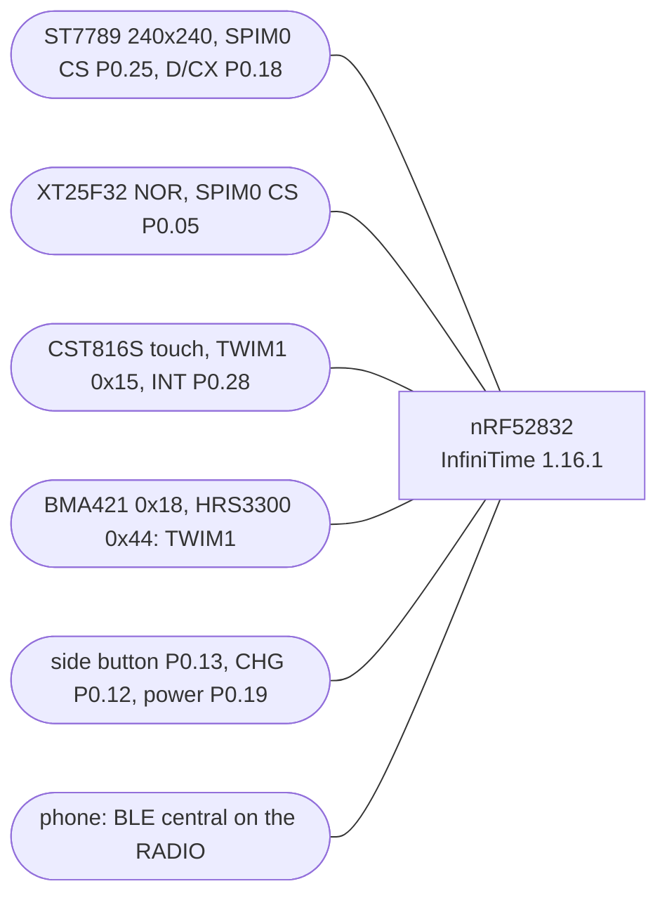

## Run InfiniTime on a simulated PineTime


The same run as an MP4 (1920x1080, 30 fps): [demo.mp4](docs/screens/demo.mp4). Pixels are the ones the firmware clocks into the ST7789 over SPI, scaled up by nearest neighbour; the watch body around them is drawn by `scripts/watch_render.py`. The GIF and the run cover 100 virtual s (every display change).

[InfiniTime](https://github.com/InfiniTimeOrg/InfiniTime) 1.16.1 (GPL-3.0), built for the PineTime (`pinetime-app`, no MCUBoot, linked at 0x0 and loaded directly), on pyrite, the Simantic simulator. The fork carries one firmware change, described under [Connection parameters](#connection-parameters): 10 s after connecting, the watch asks the phone for a 45-60 ms connection interval with peripheral latency 4. It trades phone-to-watch latency for radio activity.

| | |
| --- | --- |
| InfiniTime | this tree: tag 1.16.1 (`e172b9b`) plus the connection parameter request (simantic-dev/InfiniTime#5), `scripts/build_infinitime.sh` (arm-none-eabi-gcc 15, nRF5 SDK 15.3.0) |
| pyrite | simantic-dev/pyrite#3977 (`agent/connupd-f6a3` at `da06b80e9`, open): the scripted phone grants L2CAP connection parameter update requests. The nRF52832 chip is declared by simantic-dev/pyrite#3710 (merged) on the nRF52840's shared IP models |
| Peers | from `simantic-dev/sim-fixtures` `tests/nrf/pinetime` and `peers/` (#1295, #1307, #1308), copied here |

```sh
./run.sh    # builds InfiniTime if out/ has no image, runs 100 virtual s (about 20 s wall on an Apple M5), writes out/frames/, out/activity.md, the GIF and the MP4
```

**Timeline** (virtual time, one `./run.sh` run).

| Time (s) | What | Image |
| --- | --- | --- |
| 0.027 | first BLE ADV_IND on the air | |
| 1.6 | first frames: boot logo, then the watch face at 00:00, THU 1 JAN 2026 | [png](docs/screens/watchface.png) |
| 6.0 | the phone connects (30 ms connection interval) | |
| 6.04 to 6.10 | phone writes the Current Time characteristic (0x2A2B); the face shows 14:30, WED 18 NOV 2026 and the Bluetooth icon | |
| 16.0 | the watch asks for 45-60 ms, latency 4, timeout 4 s (L2CAP Connection Parameter Update Request); the phone grants 60 ms, applied at 16.3 | |
| 21 | the display times out | |
| 45.0, 61.0 | side button (P0.13) held 150 ms, each after a display timeout: the face is shown again for 15 s | |
| 78.0 to 91.6 | phone walks the GATT characteristic declarations to find New Alert (0x2A46), 600 ms per round trip at the slow interval | |
| 91.6 | phone writes one alert, "Alex" / "Lunch 12:30?", in the format of `doc/ble.md`; accepted at 92.2, drawn from 92.0 | [png](docs/screens/notification.png) |



### What is real and what is simulated

The firmware is real: InfiniTime built from this tree (1.16.1 plus the connection parameter request). On the chip, pyrite's shared nRF52840 IP models (CPU, GPIOTE, SPIM/TWIM, RTCs, timers, SAADC, radio) declared with the nRF52832 memory map. Off the chip, one Python model per part in `peers/`, wired up in `sim/overlay.board` after InfiniTime's `src/drivers/PinMap.h`:

- **ST7789 LCD** `peers/spi/st7789.py`: decodes the panel's commands and frame memory and saves every frame as a PNG named by virtual microseconds (this fork changes the peer's `{n}` from a frame counter to the time, for `scripts/demo_gif.py`).
- **XT25F32 NOR** `peers/spi/xt25f32.py`; **CST816S touch** `peers/i2c/cst816s.py` (no touches scripted here).
- **Phone** `peers/ble/phone.py`: pyrite's scripted BLE central. Connects at a 30 ms interval, writes the time over the Current Time Service, grants the watch's connection parameter request with Interval_Max (the prelude's default, as Apache NimBLE's central does), writes one alert to the Alert Notification Service at 78 s. InfiniTime is also a GATT client of the phone; every request it sends gets "attribute not found".
- **Buttons and charger** `peers/gpio/pin_script.py`.
- **MODELED SIMPLIFICATION:** the BMA421 accelerometer (0x18) and HRS3300 heart-rate sensor (0x44) are register files (chip id only). They stand in for the sensors: no samples, no step count, no motion or heart-rate interrupts, so every sensor-driven wakeup on silicon is absent from the study below.
- **MODELED SIMPLIFICATION:** the battery is a fixed 3.9 V on SAADC AIN7, charger unplugged.

### Activity study

Activity, not energy: no current or joule is fitted anywhere. From one run of this tree (with the connection parameter request) (`out/activity.md`, made by `scripts/activity.py` from `--trace-interrupts` and two `--trace-symbol` hooks on the WFE in FreeRTOS's `vPortSuppressTicksAndSleep`, `src/FreeRTOS/port_cmsis_systick.c:181`):

- **awake**: share of the window the CPU is outside that WFE loop. It is the only place InfiniTime sleeps (the one `wfe` in the image).
- **wakeups/s**: exits from that loop.
- **IRQ entries/s**: exception entries, total and by source. Radio on-time is not measured; RADIO IRQ entries stand in for radio events.

| Phase | window (s) | awake | wakeups/s | IRQ entries/s | top sources (entries/s) |
|---|---|---|---|---|---|
| boot | 0-2 | 65.5% | 266 | 2097 | SPIM0 (display, NOR) 762, RTC1 (tick) 663, PendSV 329, RADIO 174, RTC0 116 |
| advertising, watch face | 2-6 | 7.8% | 293 | 771 | PendSV 383, RADIO 174, RTC0 116, RTC1 (tick) 69, POWER_CLOCK 29 |
| connected, watch face | 7-15 | 7.3% | 233 | 576 | PendSV 312, RADIO 100, RTC0 67, RTC1 (tick) 64, POWER_CLOCK 33 |
| connected, display off | 22-44 | 1.8% | 30 | 71 | PendSV 40, RTC1 (tick) 11, RADIO 10, RTC0 7, POWER_CLOCK 3 |
| connected, watch face idle | 46-60, 62-76 | 6.9% | 76 | 229 | PendSV 137, RTC1 (tick) 60, SPIM0 (display, NOR) 13, RADIO 10, RTC0 7 |
| notification shown | 92-99 | 17.2% | 457 | 2002 | SPIM0 (display, NOR) 1622, PendSV 209, RTC1 (tick) 151, RADIO 10, RTC0 7 |

Task switches on an idle watch face, measured before the connection parameter change (30 ms interval; from a hook on `PendSV_Handler` after `vTaskSwitchContext`): IDLE 184/s, nimble LL 67/s, displayapp 50/s, MAIN (SystemTask) 11/s.

**Caveats.** Timing is the nRF52840 core table; the 52832 is not measured. The 30 ms interval before the update and the granted 60 ms (Interval_Max) are the scripted phone's choices, so "connected" rows depend on the phone. Advertising was measured only in the fast-advertising window. There is no sleeping-display advertising phase, and no silicon reference run yet.

**Ranked findings** (by activity removed, each tied to a code location; none is a claim about energy):

1. **displayapp wakes 50 times a second on a static watch face** (and keeps the CPU awake ~7% of the time with the display on, against 2.5% with it off). `DisplayApp.cpp:266` passes the return of `lv_task_handler()` to the next `xQueueReceive` timeout, and LVGL's refresh and input timers are 20 ms (`src/libs/lv_conf.h:45` `LV_DISP_DEF_REFR_PERIOD`, `:115` `LV_INDEV_DEF_READ_PERIOD`). Letting LVGL's timers idle longer when nothing is animating removes most of the 50/s.
2. **The SPI display path costs about 1600 IRQs/s while a screen animates** (notification window), against 0 on the static face. `SpiMaster::Write` (`src/drivers/SpiMaster.cpp`) waits for `EVENTS_END` by polling (`while (spiBaseAddress->EVENTS_END == 0)`), so the CPU is held awake for each transfer as well. Larger EasyDMA transfers per flush and waiting on the IRQ instead of polling would reduce both.
3. **Fast advertising runs for the first 30 s of every advertising period** at 20 to 29 ms (`NimbleController.cpp:152-153`, `itvl_min 32` / `itvl_max 47` for 15 starts of 2 s): 29 ADV events/s, 174 RADIO and 116 RTC0 IRQs/s, the highest radio activity outside boot. After that it drops to 1.02 to 1.03 s (`:156-157`); that slow phase is not in this run.
4. **Each BLE connection event the watch answers costs about 3 RADIO IRQs, 2 RTC0 IRQs, one POWER_CLOCK IRQ and about 6 context switches** (before the change, display off: RADIO 100, RTC0 67, POWER_CLOCK 33, PendSV 220 per second at 33 events/s). Addressed by the connection parameter request below: 3.3 answered events/s.
5. **Boot keeps the CPU awake 65% of the first 2 s**, with SPIM0 762 and RTC1 tick 659 IRQs/s (display initialisation and the first draw). It happens once.
6. **IDLE is switched in 184 times a second on an idle watch face** (PendSV 311/s). Every wake returns to idle through a full context switch; findings 1 and 4 remove the wakes themselves.

### Connection parameters

Stock InfiniTime 1.16.1 never asks for connection parameters (no `ble_gap_update_params` in `src/`), so it keeps the phone's interval. This fork's one firmware change (`src/components/ble/NimbleController.cpp`, `RequestSlowConnection`): 10 s after connecting, so the phone's time sync and discovery run at its own interval, the watch asks for

- **interval 45-60 ms, peripheral latency 4, supervision timeout 4 s.** These fit Apple's Accessory Design Guidelines connection-parameter rules (Interval Min >= 15 ms; Interval Min + 15 ms <= Interval Max; Interval Max x (latency + 1) <= 2 s; 2 s <= timeout <= 6 s; Interval Max x (latency + 1) x 3 < timeout) and the Core spec's timeout > (1 + latency) x interval x 2 (600 ms). PebbleOS asks for the same 45-60 ms with latency 4 when idle.
- On failure (`ble_gap_update_params` error or a failed `BLE_GAP_EVENT_CONN_UPDATE`) it retries 10 s later, at most 3 attempts per connection; a successful update logs the granted interval, latency and timeout.

**The trade.** With latency 4 the watch listens on one connection event in five when idle (every 300 ms at 60 ms). A phone-to-watch packet waits up to 300 ms for the watch to listen, and the vendored NimBLE controller (`ble_ll_conn.c:2189-2196`) applies the latency after every received packet even when the watch has a reply queued, so each request/response round trip takes about 600 ms instead of 60 ms. One notification write is accepted after 600 ms; a phone that walks GATT or pushes bulk data (DFU, file transfer) is slowed tenfold unless it asks for a faster interval or latency 0 itself, which a central can always do. The watch does not request a faster interval for DFU or file transfer (follow-up below).

Same scenario, fork `main` (before) and this tree (after), `pyrite` from #3977:

| | before | after |
|---|---|---|
| interval / latency / timeout | 30 ms / 0 / 4 s (phone's CONNECT_IND) | 60 ms / 4 / 4 s, granted (Interval_Max), applied at 16.3 s |
| connection events/s on air (display off / on) | 33.3 / 33.3 | 16.7 / 16.7 |
| events answered by the watch/s | 33.3 / 33.3 | 3.4 / 3.3 |
| awake, display off (22-44 s) | 2.5% | 1.8% |
| awake, display on (46-60, 62-76 s) | 7.2% | 6.9% |
| wakeups/s, display off / on | 205 / 233 | 30 / 76 |
| IRQ entries/s, display off | 438: PendSV 220, RADIO 100, RTC0 67, POWER_CLOCK 33, RTC1 18 | 71: PendSV 40, RTC1 11, RADIO 10, RTC0 7, POWER_CLOCK 3 |
| IRQ entries/s, display on | 589: PendSV 311, RADIO 100, RTC0 67, RTC1 65, POWER_CLOCK 33, SPIM0 13 | 229: PendSV 137, RTC1 60, SPIM0 13, RADIO 10, RTC0 7, POWER_CLOCK 3 |
| time set (phone writes CTS, before the update) | 6.10 s | 6.11 s |
| notification: write to accepted / to first frame drawn | 60 ms / 140 ms | 600 ms / 395 ms |
| phone's New Alert discovery walk (23 round trips) + write | 1.36 s | 13.6 s |

Events on air and answered are counted from `out/ble.pcap` (a packet within 1 ms of the previous one is the watch's answer). With the display on, the 50/s displayapp wakeups (finding 1) dominate, so the change saves little there; with it off, wakeups drop sevenfold.

### Open

- Request a faster interval (latency 0) while DFU or file transfer runs: `SystemTask` already gets `BleFirmwareUpdateStarted` and `StartFileTransfer`. Not measured here: the scenario has no DFU.

- The accelerometer and heart-rate sensors are register files, so their activity (step counting, HR sampling, motion interrupts) is absent. A BMA421 and HRS3300 peer would add it.
- No silicon comparison; the PineTime is not on the bench.

**Needs** Python 3 with Pillow, ffmpeg, a pyrite `sim` with simantic-dev/pyrite#3977 (connection parameter updates; without it the phone never answers the watch's request) (`SIM=/path/to/sim ./run.sh`), arm-none-eabi-gcc, cmake and npm to build InfiniTime.

**This repo is a fork of [InfiniTimeOrg/InfiniTime](https://github.com/InfiniTimeOrg/InfiniTime)**, so the firmware the demo runs is the tree you are in. `out/` is git-ignored. The peers are copies from `simantic-dev/sim-fixtures` (GPL-3.0 firmware; the peers and scripts are ours).
